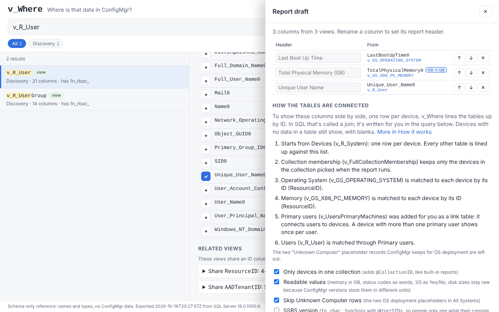

# v_Where

**Where is that data in ConfigMgr?** Search Microsoft Configuration Manager's SQL views in plain words, pick the columns you need, and get a working query or a ConfigMgr-ready SSRS report. No SQL required.

**[Open v_Where](https://jboogieman.github.io/v-where/)** · [User guide](docs/user-guide.md) · [Executive summary](docs/executive-summary.md) · [Roadmap](https://github.com/JBoogieman/v-where/milestones)

## How it works

1. **Search in plain words:** `ram`, `last boot`, `bitlocker`, `primary user`. Everyday words are translated into ConfigMgr's names, and results list the views (tables) that hold the data, with the matching columns listed first and highlighted.
2. **Click + on the columns you want,** from as many views as you need.
3. **Open Report draft.** v_Where connects the views for you (one row per device), explains each connection in plain English, and gives you the SQL or a ConfigMgr-ready `.rdl` report.

Hover over anything on the page for a short explanation, or open **How it works** for a glossary.

## What it knows

- **841 views, 625 permission-filtered `fn_rbac_` functions and 22,457 columns** from a ConfigMgr current branch lab site.
- **Which hardware inventory classes and columns aren't collected by default:** the view exists but stays empty until someone turns them on in Client Settings.
- **The Windows (WMI) class behind each inventory view,** and each view's `fn_rbac_` version for SSRS reports.
- **Plain-English descriptions for about 160 of the most-used columns,** like "Installed memory, in KB" under `TotalPhysicalMemory0`.

## What it touches

Nothing in your environment. v_Where is a static web page: it searches a file of view and column names, with no device or user data in it, and never connects to a ConfigMgr database. The SQL and reports it writes only read data, and only when someone runs them.

## Run it yourself

| To | Do this |
| --- | --- |
| Use it offline | `python3 tools/build_offline.py` builds `dist/v_where.html` (about 1 MB). Copy it anywhere and double-click it. |
| Use your own site's schema | Run `extractor/Export-VWhereSchema.sql` with sqlcmd (works where PowerShell is locked down) or `extractor/Export-VWhereSchema.ps1` against your site database, then build the offline copy with `--schema`. See the [user guide](docs/user-guide.md#4-use-your-own-sites-schema). |
| Develop locally | From the repo root, `python3 -m http.server 8000`, then browse to `http://localhost:8000/web/`. |
| Run the tests | `node tools/test_search.js`, `node tools/test_joinplan.js` and `node tools/test_rdl.js`. They also run on every push and pull request. |

## Docs

| Doc | For |
| --- | --- |
| [User guide](docs/user-guide.md) | Finding data, building a report, putting it in ConfigMgr, using your own schema |
| [Executive summary](docs/executive-summary.md) | What it is, how it's built, where it stands |
| [How the connections work](docs/how-connections-work.md) | What happens when you add columns from several views |
| [Lab build](docs/lab-build.md) | The Proxmox lab the bundled schema comes from |
| [Contributing](CONTRIBUTING.md) | Reporting a search miss or a bug, running the tests, sending a change |
| [Changelog](CHANGELOG.md) | What changed in each version |

## Project layout

| Path | What's there |
| --- | --- |
| `web/` | The page (`index.html`), search (`search.js`), column descriptions (`columns.js`), the join planner (`joinplan.js`) and the .rdl builder (`rdl.js`) |
| `data/schema.json` | Schema export from the lab site |
| `extractor/` | The schema exporter: T-SQL for sqlcmd, or PowerShell |
| `tools/` | Offline build script and tests |
| `lab/` | Scripts and config used to build the lab |
| `docs/` | Documentation |

## Status

Version 0.1.0: see the [changelog](CHANGELOG.md). Planned work is tracked as [milestones](https://github.com/JBoogieman/v-where/milestones) and [issues](https://github.com/JBoogieman/v-where/issues).

## Data policy

All schema data comes from a lab ConfigMgr site built for this project. No production data, hostnames or organization details belong in this repo.

## Acknowledgment

Every project begins with a thought. AI was used to help bring this vision to life.

## License

[MIT](LICENSE). v_Where is an independent project and is not affiliated with or endorsed by Microsoft.
