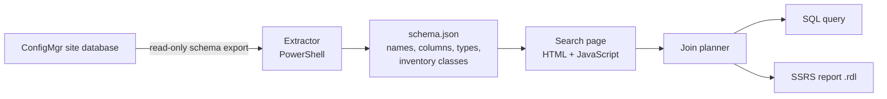

# v_Where: Executive Summary

*Version 0.1.0 · October 2026 · MIT license*

## The problem

Microsoft Configuration Manager (MECM/SCCM) stores everything it knows about devices in **841 SQL views and 22,457 columns**. The names don't say what they hold. Writing a report starts with hunting for which view has the data, how to join it, and whether it's even collected. Built-in reports answer narrow questions; custom reports need SQL most admins don't have time to learn.

## What v_Where is

A free, open-source reference and report starter for ConfigMgr's SQL views:

1. **Search** in plain words (`ram`, `last logon`, `bitlocker`) and see which views and columns hold it.
2. **Click +** on the columns you want, from any views. v_Where connects the views for you and explains each connection in plain English.
3. **Download a ConfigMgr-ready SSRS report** (.rdl) that respects console permissions, or copy the SQL.

It runs as a static web page or a single offline HTML file. No server, no database connection, no install. It never touches device or user data.

## How it works

| Component | What it does | Size |
| --- | --- | --- |
| Extractor (`extractor/`) | Reads view and function names, columns, types and hardware inventory class definitions. Schema only: never reads device or user data. | ~230 lines PowerShell, or ~170 lines of T-SQL run with sqlcmd (no PowerShell needed) |
| Schema data (`data/`) | Export from the lab site: 841 views, 625 permission-filtered `fn_rbac_` functions, 311 inventory views (140 not collected by default) | ~1 MB JSON |
| Search page (`web/index.html`) | Results, category filters, "not collected by default" and history flags, links to `fn_rbac_` versions, shareable links, hover help, a How it works panel, phone layout | ~870 lines |
| Search (`web/search.js`) | Translates everyday words into ConfigMgr names, ranks views, keeps only columns that match the whole search, highlights whole words | ~370 lines, 26 tests |
| Column descriptions (`web/columns.js`) | One-line, plain-English descriptions for about 160 of the most-used columns | ~220 lines, 4 tests |
| Join planner (`web/joinplan.js`) | Builds one query around the device list, adds link tables for users, updates and collections, warns when a view repeats devices (and louder when two of them multiply), leaves out obsolete records that would show a device twice, adds filters and report parameters (a filter on a view not in the report uses EXISTS, so it can't repeat a device), converts codes and units to readable values, and explains each connection in plain English | ~560 lines, 48 tests |
| Query explainer (`web/sqlexplain.js`) | Paste any ConfigMgr query: explains each view and column, flags rows that multiply, history views, missing columns and unfiltered obsolete records, and converts between plain views and `fn_rbac_` | ~200 lines, 10 tests |
| Report builder (`web/rdl.js`) | Turns a draft into an RDL 2008/01 report: shared data source, permission parameters, collection picker, filter parameters, sortable table | ~240 lines, 11 tests |
| Delivery | GitHub Pages site and a single-file offline build (`tools/build_offline.py`) | ~1 MB HTML |

More detail: [How the connections work](how-connections-work.md) · [User guide](user-guide.md) · [Lab build](lab-build.md)

## Where it stands

| Area | Status |
| --- | --- |
| Lab | Built: Proxmox host, domain controller, ConfigMgr current branch on SQL Server 2022, Windows 11 client |
| Search | Working against the lab export; tested against common searches |
| Join planner | Working; unit tested |
| .rdl output | Working; checked against Microsoft's RDL schema |
| In-page help | Hover explanations, How it works panel, plain-English connections in the Report draft, column descriptions |
| Tests | 103 tests (search, join planner, .rdl, query explainer, schema file tools) run on every push and pull request; the site only deploys if they pass. The T-SQL exporter is checked against the PowerShell one on the lab site |
| Hosting | Live on GitHub Pages; offline build available |

**Data policy:** all schema data comes from a lab site. No production data, hostnames or organization details are in the repo.

## Known limits

- **Hand-tuned search.** Synonyms and ranking rules are written by hand and tested against common searches; unusual wording can still miss.
- **Column descriptions cover the common columns only:** about 160 of 22,457. The rest show name and type.
- **Join planner shape.** It joins everything around the device list and can't follow longer chains (deployment to assignment to collection). It infers keys from column names because ConfigMgr views declare no relationships.
- **One schema.** The bundled data reflects one lab site and version. Custom inventory classes need your own export.

## Roadmap

Work is tracked as [milestones](https://github.com/JBoogieman/v-where/milestones) and [issues](https://github.com/JBoogieman/v-where/issues):

| Phase | Goal | Status |
| --- | --- | --- |
| 1. Explain the page | Hover help, How it works panel, plain-English connections | Done |
| 2. Docs and README | A README that leads with the tool, a user guide, how the connections work, this summary | Done |
| 3. Search quality | Exact matches first, less synonym noise, history views labeled, column descriptions, phone layout | Done |
| 4. Project hygiene | Tests on every push, tagged releases with a changelog, issue templates and contributing notes | Done (v0.1.0) |
| 5. Reach | Export that works in locked-down PowerShell, longer join chains, feedback from other ConfigMgr admins | Next |

---

*v_Where is an independent project and is not affiliated with or endorsed by Microsoft.*
