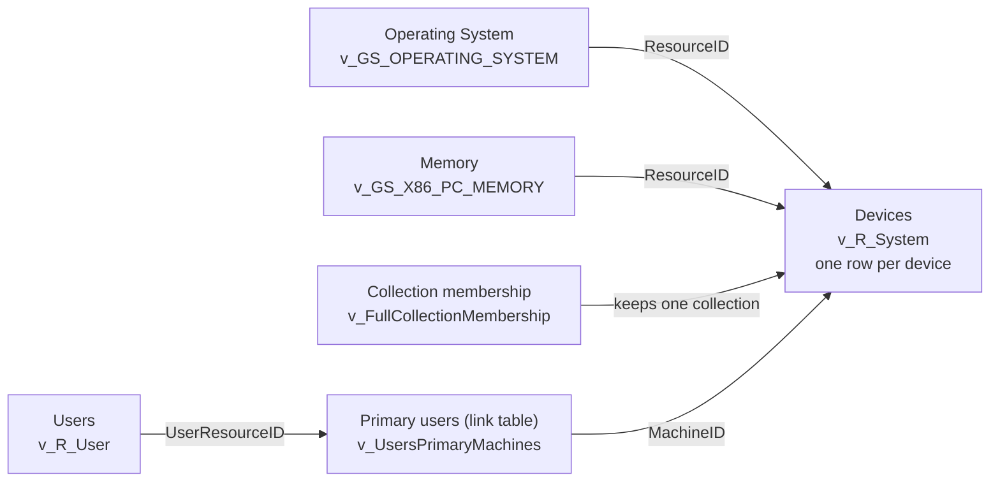

# How the connections work

When you add columns from more than one view, v_Where has to put them side by side, one row per device. In SQL that's a **join**: matching rows in different tables by an ID they share. You never write one. Clicking **+** says "I want this column"; the join planner (`web/joinplan.js`) works out the joins, and the Report draft lists each one in plain English.

This page explains what the planner does, and what it can't do yet.

## The short version



Every report starts from the device list. Each view you pick is lined up against it by device ID. Views that don't have a device ID (users, updates, collections) go through a link table that has both IDs.

## Step by step

### 1. Start from the device list

Most ConfigMgr reports are "one row per device", so the planner starts from **v_R_System**, the device list. Every other table is lined up against it.

If every view you picked is about users (v_R_User and friends), it starts from **v_R_User** instead: one row per user.

### 2. Sort each view by the ID it carries

The planner reads each view's column names (from the schema export) and sorts it by the key it carries:

| The view has | Meaning | How it's connected |
| --- | --- | --- |
| `ResourceID`, `MachineID` or `MachineResourceID` | A device ID | Straight to the device list |
| `ResourceID` in a user discovery view, or `UserResourceID` | A user ID | Through the primary users link table |
| `CI_ID` only | An update or configuration item | Through the update or compliance status link table |
| `CollectionID` only | A collection | Through collection membership |
| None of these | Nothing to match on | Left out, with a note saying why |

### 3. Line up the device views

Each view with a device ID is matched on it, for example `os.ResourceID = sys.ResourceID`. These are **left joins**: a device with no data in that view still shows, with blanks, instead of disappearing from the report.

### 4. Add link tables when two views share no ID

A link table holds two kinds of ID, so it can connect things that don't share one. The planner adds it for you, once, and says so in the Report draft.

| To connect | Link table | It holds | Watch out for |
| --- | --- | --- | --- |
| Users to devices | `v_UsersPrimaryMachines` | `MachineID` and `UserResourceID` | A device with more than one primary user shows once per user |
| Updates to devices | `v_UpdateComplianceStatus` | `ResourceID` and `CI_ID` | One row per device per update |
| Configuration items to devices | `v_CICurrentComplianceStatus` | `ResourceID` and `CI_ID` | One row per device per configuration item |
| Collections to devices | `v_FullCollectionMembership` | `ResourceID` and `CollectionID` | One row per device per collection; use the collection filter to keep one |

If you already picked a view that carries both IDs, the planner reuses it instead of adding another.

### 5. Filter

- **Only devices in one collection** (on by default) joins `v_FullCollectionMembership` with `@CollectionID`, the same way built-in ConfigMgr reports do. The report asks which collection when it runs.
- **Skip stale records** (on by default) leaves out records that aren't a current device:
    - obsolete records: when a device is reinstalled or gets a new ConfigMgr ID, its old record is kept and marked obsolete, so without this the device shows twice;
    - decommissioned records;
    - the two "x64/x86 Unknown Computer" placeholder records ConfigMgr keeps for OS deployment.
- **Your filters** go in the `WHERE` too. A filter on a view that's already in the report is applied to it in place (`os.LastBootUpTime0 < DATEADD(day, -30, GETDATE())`). A filter on any other view linked to devices becomes an `EXISTS` check, so it narrows the devices without joining the view and repeating them:

```sql
AND EXISTS (SELECT 1 FROM v_GS_ADD_REMOVE_PROGRAMS flt1
            WHERE flt1.ResourceID = sys.ResourceID AND flt1.DisplayName0 LIKE N'%' + @DisplayName + N'%')
```

  A filter set to **Ask** uses a parameter (`@DisplayName`) that the downloaded .rdl declares, with the typed value as its default. Typed values are quoted, and numbers and dates are checked, so nothing typed can change the query.

### 6. Warn about repeats

Some views have more than one row per device: one per drive, per CPU socket, per network adapter. Joining one repeats each device once per row. The planner warns you (a yellow note), and for common cases offers a one-click fix that keeps one row:

| View | Has | "Keep one row" fix |
| --- | --- | --- |
| `v_GS_LOGICAL_DISK` | one row per drive | `DeviceID0 = 'C:'` |
| `v_GS_BITLOCKER_DETAILS` | one row per drive | `DriveLetter0 = 'C:'` |
| `v_GS_ENCRYPTABLE_VOLUME` | one row per drive | `DriveLetter0 = 'C:'` |
| `v_GS_DISK` | one row per physical disk | `Index0 = 0` |
| `v_GS_PROCESSOR` | one row per CPU socket | `DeviceID0 = 'CPU0'` |
| `v_GS_NETWORK_ADAPTER_CONFIGURATION` | one row per network adapter | `IPEnabled0 = 1` |

Views known to have one row per device get no warning: `v_R_System`, `v_GS_OPERATING_SYSTEM`, `v_GS_COMPUTER_SYSTEM`, `v_GS_COMPUTER_SYSTEM_PRODUCT`, `v_GS_PC_BIOS`, `v_GS_X86_PC_MEMORY`, `v_GS_SYSTEM_CONSOLE_USAGE`, `v_GS_WORKSTATION_STATUS`, `v_GS_TPM`, `v_GS_FIRMWARE` and `v_CH_ClientSummary`. Everything else gets a "can return more than one row per device" warning. The list is kept short on purpose: a false warning costs a glance, a missing one costs a wrong report.

**When repeats multiply.** Two tables that each repeat a device multiply each other: 3 drives and 150 installed programs make 450 rows for one device, and a fleet of 3,000 laptops becomes over a million rows. Link tables count too (a device with two primary users, or one row per update). When a draft has two or more of these, the Report draft shows a red **Devices will repeat in this report** note right under the columns, with the one-click fixes that apply. The **Report draft** button's count turns red, and the query starts with a `-- WARNING: rows multiply` comment. Keep one row where it's offered, or split the report in two.

### 7. Write the query

The planner's result becomes SQL. With **Readable values** on, raw codes and units are converted in the query itself (memory in GB, status codes as words, 1/0 as Yes/No). With **SSRS version** on, or in a downloaded `.rdl`, every view that has a permission-filtered `fn_rbac_` version is swapped for it, with `@UserSIDs`, so people only see the devices their console role allows.

## Example

Picking Last Boot Up Time (Operating System), Total Physical Memory (Memory) and Unique User Name (Users) gives this query:

```sql
SELECT
  os.LastBootUpTime0 AS [Last Boot Up Time],
  CAST(ROUND(mem.TotalPhysicalMemory0 / 1048576.0, 1) AS decimal(10,1)) AS [Total Physical Memory (GB)],
  usr.Unique_User_Name0 AS [Unique User Name]
FROM v_R_System sys
JOIN v_FullCollectionMembership fcm ON fcm.ResourceID = sys.ResourceID AND fcm.CollectionID = @CollectionID
LEFT JOIN v_GS_OPERATING_SYSTEM os ON os.ResourceID = sys.ResourceID
LEFT JOIN v_GS_X86_PC_MEMORY mem ON mem.ResourceID = sys.ResourceID
LEFT JOIN v_UsersPrimaryMachines upm ON upm.MachineID = sys.ResourceID
LEFT JOIN v_R_User usr ON usr.ResourceID = upm.UserResourceID
WHERE ISNULL(sys.Unknown0, 0) = 0
  AND ISNULL(sys.Obsolete0, 0) = 0
  AND ISNULL(sys.Decommissioned0, 0) = 0   -- skip Unknown Computer placeholders, obsolete and decommissioned records
```

And the Report draft explains it like this:

1. Starts from Devices (v_R_System): one row per device. Every other table is lined up against this list.
2. Collection membership (v_FullCollectionMembership) keeps only the devices in the collection picked when the report runs.
3. Operating System (v_GS_OPERATING_SYSTEM) is matched to each device by its ID (ResourceID).
4. Memory (v_GS_X86_PC_MEMORY) is matched to each device by its ID (ResourceID).
5. Primary users (v_UsersPrimaryMachines) was added for you as a link table: it connects users to devices. A device with more than one primary user shows once per user.
6. Users (v_R_User) is matched through Primary users.

The two "Unknown Computer" placeholder records ConfigMgr keeps for OS deployment are left out.

Obsolete and decommissioned records are left out, so a reinstalled device shows once, not once per record.

## What it can't do yet

- **Only a star around the device list.** It can't follow longer paths, such as deployment to assignment to collection. ([#16](https://github.com/JBoogieman/v-where/issues/16))
- **Keys are guessed from column names.** ConfigMgr's views declare no relationships, so the planner relies on naming. A view that names its device ID something unusual gets left out.
- **The one-row list is kept by hand.** A multi-row view missing from the warnings would repeat devices silently, which is why anything not on the list gets a warning.

## Where it lives in the code

All of this is in `web/joinplan.js`, plain JavaScript with no dependencies:

| Name | What it is |
| --- | --- |
| `plan()` | Steps 1 to 6: picks the starting table, sorts views, adds joins, link tables, filters and warnings |
| `toSQL()` | Step 7: turns the plan into SQL |
| `explain()` | The plain-English list in the Report draft |
| `BRIDGES` | The link tables |
| `ONE_ROW` | Views known to have one row per device |
| `PICK_ONE` | The "keep one row" fixes |
| `FORMATS` | Readable values |
| `OPS`, `filterCond()` | Filter conditions and how each becomes SQL |

Tests: `node tools/test_joinplan.js` (add `--show` to print each generated query).
