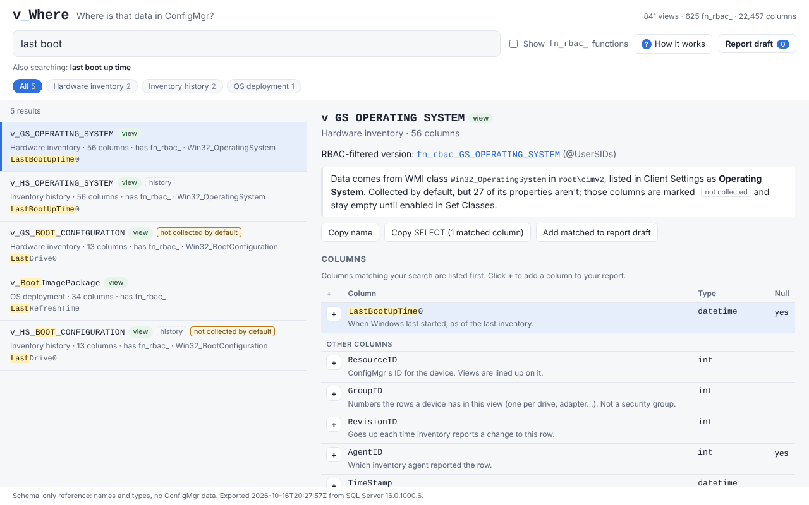

# v_Where user guide

v_Where answers "which ConfigMgr view holds this?" and then builds the report for you. This guide covers the four things people do with it: find data, build a report, put the report in ConfigMgr, and use your own site's schema.

New to ConfigMgr's tables? Click **How it works** at the top of the page for the three steps and a glossary, and hover over anything for a short explanation.

## 1. Find where the data lives



**Search in plain words.** Type what you'd call it: `last boot`, `ram`, `bitlocker`, `primary user`, `serial number`. Everyday words are translated into ConfigMgr's names (`ram` → physical memory, `uptime` → LastBootUpTime, `kb` → ArticleID). The line under the search box shows what else is being searched.

**Read a result.** Each card on the left is one view (a read-only table):

- **Line 1:** the view name. An orange **not collected by default** tag means the view exists but stays empty until someone turns that inventory class on in Client Settings. A **history** tag means it holds earlier values (see below).
- **Line 2:** its area (Hardware inventory, Discovery...), how many columns it has, whether it has a permission-filtered `fn_rbac_` version, and the Windows (WMI) class the data comes from.
- **Line 3:** the columns that matched your search, highlighted.

The view name tells you where the data comes from: `v_GS_` is the latest hardware inventory (usually what you want), `v_HS_` is inventory history, `v_R_` is discovery, `v_CH_` is client health. The trailing `0` in names like `LastBootUpTime0` means nothing; ignore it.

**History views** (`v_HS_`) keep a row each time inventory sees a change, so devices repeat. They're for "what changed and when". They rank below their current `v_GS_` view, and opening one links to it.

**Narrow it down.** The category chips filter by area. **Show fn_rbac_ functions** adds the permission-filtered versions to the list; most searches don't need them.

**Open a view.** Click a result to see:

- where its data comes from and whether ConfigMgr collects it by default;
- **Copy name** and **Copy SELECT** (a ready-to-run query for this view on its own);
- every column, with the ones matching your search listed first and highlighted, a one-line description under the common ones, and **+** to add one to your report;
- **Related views:** other views sharing an ID column with this one.

**Shortcuts:** `/` jumps to the search box; `↑` `↓` move through results; `Enter` opens the first one. The address bar updates as you search, so you can send someone a link to the same result.

**On a phone,** the results and the view you open stack on one page. Tap a result to jump to it, and **← Results** to go back.

## 2. Build a report


1. **Pick columns.** Open any view and click **+** next to the columns you want. Pick from as many views as you need. **Add matched to report draft** adds every highlighted column at once.
2. **Open Report draft** (top right). Your columns are listed in report order:
    - type in **Header** to rename a column in the report;
    - use the arrows to reorder, and **✕** to remove.
3. **Check "How the tables are connected."** It explains, one line per table, how v_Where lined your views up. [How the connections work](how-connections-work.md) goes deeper.
4. **Check the options:**

| Option | Default | What it does |
| --- | --- | --- |
| Only devices in one collection | On | Adds `@CollectionID`; the report asks which collection when it runs |
| Readable values | On | Memory in GB, status codes as words, 1/0 as Yes/No. Disk sizes stay raw, because ConfigMgr versions store them in different units |
| Skip Unknown Computer rows | On | Leaves out the two OS deployment placeholder records |
| SSRS version | Off | Uses the permission-filtered `fn_rbac_` versions with `@UserSIDs` (the downloaded .rdl always does) |

5. **Fix repeats.** A yellow note means a view has more than one row per device (one per drive, per adapter...), so devices would repeat. Where there's a common fix, click **Keep one row** (for example, only the C: drive).

The draft is saved in your browser, so it's still there next time you open the page on the same computer.

**Run the query yourself:** **Copy query** gives you the SQL. In SQL Server Management Studio, declare the parameters first:

```sql
DECLARE @CollectionID nvarchar(8) = 'SMS00001';   -- a collection ID from your site
-- then paste the query
```

With **SSRS version** on, the query also needs `@UserSIDs`, which only a report server provides. Run it with that option off.

## 3. Put the report in ConfigMgr

1. In Report draft, under **Download as a ConfigMgr report**, enter a **Report name** and your 3-character **Site code**.
2. Click **Download .rdl**.
3. Upload the file to the `ConfigMgr_<site code>` folder (or a subfolder) in your SSRS web portal, or open it in Report Builder and save it there.
4. It shows up in the ConfigMgr console under **Monitoring > Reporting > Reports**.

The .rdl is shaped like ConfigMgr's built-in reports: it uses the site's shared data source, the permission-filtered `fn_rbac_` functions (so people only see the devices their console role allows) and a collection picker. The layout is deliberately plain (a title, the collection and row count, one table with sortable headers), so the only work left is formatting.

If it fails with a permission error on `fn_rbac_GetAdminIDsfromUserSIDs`, the account running it lacks ConfigMgr reporting rights. Ask whoever manages SSRS, or build the report in Report Builder from the plain-view query instead (not permission-filtered).

## 4. Use your own site's schema

The bundled schema comes from a lab site. Your site may have custom hardware inventory classes, or a newer ConfigMgr version, that it doesn't know about. Export your own, either way:

**With sqlcmd (no PowerShell, so it works where PowerShell is locked down to Constrained Language Mode):**

```
sqlcmd -S <sql-server> -d CM_<site code> -E -I -b -f o:65001 -i extractor\Export-VWhereSchema.sql -o schema.json
```

sqlcmd comes with SQL Server's command line tools, so it's already on the site database server. Use sqlcmd rather than SSMS: SSMS cuts long text results off, which breaks the file. sqlcmd starts a new line every 2,000 or so characters, even mid-word; that's expected, and v_Where reads the file fine.

**With PowerShell:**

```powershell
.\extractor\Export-VWhereSchema.ps1 -SqlServer <sql-server> -Database CM_<site code> -OutFile .\schema.json
```

Either way:

- It reads names and types only (SQL Server's system catalog and the inventory class definitions). It never reads device, user or inventory data.
- It uses Windows authentication, so run it as an account that can already read the site database.
- To skip the inventory class definitions (and with them the "not collected by default" flags), use `-SchemaOnly` in PowerShell, or set `@SchemaOnly = 1` at the top of the .sql file.
- `python3 tools/compare_schema.py data/schema.json schema.json` shows what's different about your site: views and columns only one has, and inventory classes collected differently.

Then use it one of two ways:

- **Offline file:** `python3 tools/build_offline.py --schema path/to/schema.json --out dist/my-site.html`, then double-click the HTML file.
- **Served:** host the page and the JSON on any web server and open the page with `?data=<url of your schema.json>`.

Your export can include custom class names specific to your organization. Keep it out of public repos.

## Troubleshooting

| What you see | Why | Fix |
| --- | --- | --- |
| The page asks you to pick a `schema.json` | You opened `web/index.html` straight from disk; browsers block it from loading the JSON | Use the offline build (`tools/build_offline.py`), or pick the file when asked |
| A column is always empty | Its inventory class or property isn't collected by default | Turn it on in Client Settings > Hardware Inventory > Set Classes, then wait for inventory |
| Devices repeat in the report | A view has more than one row per device | Use **Keep one row** in Report draft, or check the link table notes |
| A view was "left out" | It has no ID that links it to devices | Query it on its own (Copy SELECT) |
